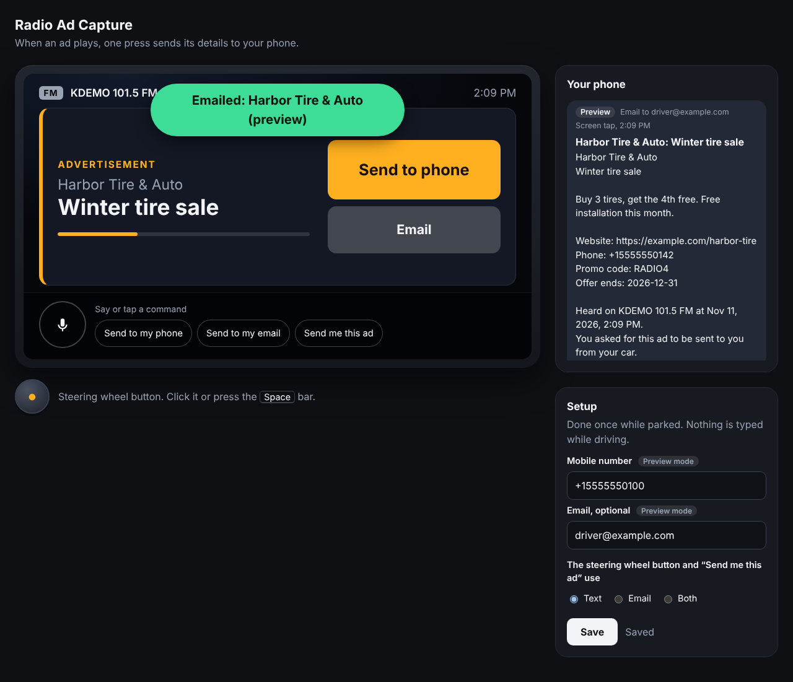

# Radio Ad Capture

A working demo of "send to phone" for car radio ads. When an advertisement
plays, the car screen shows it with a **Send to phone** button. One tap, a
steering-wheel button press, or a spoken command sends the ad's offer,
website, phone number and promo code to your phone by text or email.



This is a simulation: the car screen is a web page and the radio station is
a looping schedule of made-up songs and ads. The server behind it is the
part a real CarPlay app, a carmaker's screen or a voice assistant would call.

## Run it

Requires Node.js 20.12 or newer.

```bash
npm install
npm start
```

Open http://localhost:3000.

## Two-minute demo

1. In **Setup**, enter a mobile number in international format
   (for example `+15555550100`) and press **Save**.
2. Watch the car screen. The first ad comes on about 20 seconds after the
   server starts, and the screen switches from the song to the ad card.
3. Tap **Send to phone**. The message appears under **Your phone**.
4. Tap it again: it says "Already sent" rather than texting you twice.
5. Wait for the ad to finish. The card stays for 30 seconds labelled
   "Just heard", so a slow reaction still catches it.
6. Once the card has gone and a song is showing, press the space bar (the
   steering-wheel button). It says no ad is playing. **Send last ad**
   fetches the most recent one.
7. Tap the microphone and say "send to my phone" (Chrome, Edge or Safari),
   or tap one of the phrases next to it.

## Sending real texts and emails

With no keys configured the demo runs in **preview mode**: it shows the
exact message it would send but sends nothing. To deliver for real:

```bash
cp .env.example .env
```

Fill in either or both groups, then restart.

| Channel | Service | Values |
|---|---|---|
| Text | [Twilio](https://www.twilio.com) | `TWILIO_ACCOUNT_SID`, `TWILIO_AUTH_TOKEN`, `TWILIO_FROM` (your Twilio number) |
| Email | [Resend](https://resend.com) | `RESEND_API_KEY`, `RESEND_FROM` (an address on a domain you verified) |

Things to know:

- A Twilio trial account can only text numbers you have verified in the
  Twilio console.
- US carriers require sender registration (A2P 10DLC or toll-free
  verification) before texting the general public. This can take days.
- Messages cost money on both services once past any free allowance.

The Setup panel shows **Live** or **Preview mode** next to each channel.
Real delivery through these services has not been exercised by the
automated tests, which stub the network; the request formats are tested.

## Changing the station

Edit `src/data/broadcast-log.json`. Each entry is a song or an ad with a
duration in seconds; the list loops. Durations are short so the demo moves
quickly.

## Tests

```bash
npm test            # unit and API tests
npm run typecheck
npm run e2e         # drives the page in a real browser, takes about 90 seconds
```

`npm run e2e` needs Playwright, which is not installed by `npm install`:

```bash
npm install --no-save playwright && npx playwright install chromium
```

## How it works

```
press (tap / wheel button / voice)
   -> POST /api/capture { pressedAt, mode, channel?, trigger }
   -> which ad was on air at pressedAt?   src/schedule.ts, src/capture.ts
   -> write the message                   src/compose.ts
   -> send it                             src/delivery/ (Twilio, Resend, or preview)
```

The press is timestamped in the browser at the moment of the press, so a
slow connection cannot change which ad it matches.

The server listens on this computer only. To open the demo from another
device on your network, set `HOST=0.0.0.0` in `.env`; anyone on that network
can then read the saved phone number and email.

Your phone number and email are stored in `data/profile.json` on the
machine running the demo and are sent only to the delivery service, only
when you press. That file and `.env` are git-ignored.

## From demo to car

| Piece | What it would take |
|---|---|
| CarPlay | An iOS app whose CarPlay screen has the Send to phone button calling `POST /api/capture`. Needs Apple's CarPlay entitlement for the app's category. |
| Carmaker screens | The ad card as a small view driven by `GET /api/now-playing`, for example on Android Automotive. |
| Steering-wheel button | A control the carmaker maps to the same API call. |
| Voice | A Siri App Intent or the car's assistant calling the API with `trigger: "voice"`. |
| Knowing which ad is on air | Replace the simulated schedule with a feed from the station's playout or ad-traffic system, or with audio fingerprinting. |
| Many users | Replace the single saved profile with accounts tied to a paired phone. |

Design notes are in `docs/superpowers/specs/`.
